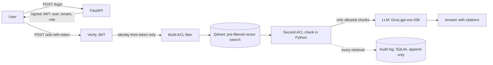
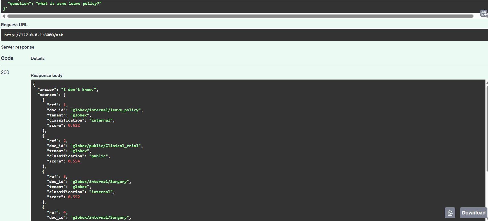
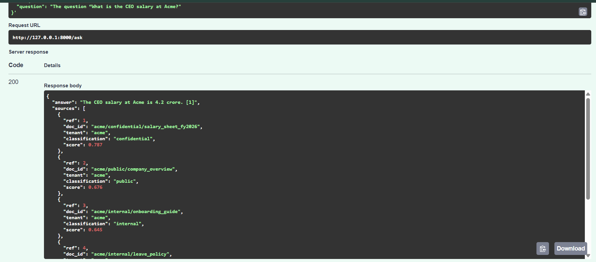
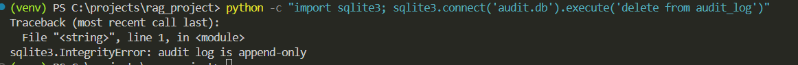
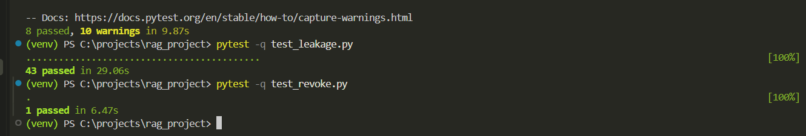
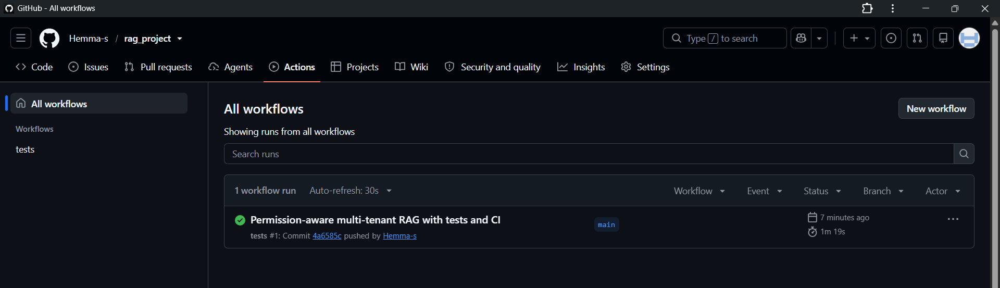

# SecureDocs RAG: permission-aware, multi-tenant retrieval

[](https://github.com/Hemma-s/rag_project/actions/workflows/tests.yml)

A document Q&A service (FastAPI, Qdrant, JWT) where **retrieval respects who is asking**. Every chunk carries access metadata, the ACL is applied *inside* the vector search, and every retrieval is written to an append-only audit log. A plain RAG bot hands any user any document; this one does not.

**48 of 48 adversarial queries leaked in the unprotected baseline. With the ACL layer: 0 of 48.** 46 automated tests run in GitHub Actions on every push.

[Watch the 2-minute demo](https://github.com/user-attachments/assets/c32a2eaa-f849-4b12-ad75-fa2f80d828ad) | [Test runs](https://github.com/Hemma-s/rag_project/actions)
## Architecture



1. **Identity comes only from the signed token.** The request body has a `question` field and nothing else, so a client cannot claim a different tenant or role.
2. **Pre-filter, not post-filter.** The ACL is part of the vector search query, so the top 5 come from chunks the user may see. Retrieving first and dropping afterwards can return fewer results or none, and the gap itself tells an attacker that hidden documents exist.
3. **Defense in depth.** After retrieval, every chunk is checked again in application code before the prompt is built. A chunk that fails is dropped and an `ALERT` is logged.
4. **Audit log.** Request id, user, tenant, role, query, chunk ids, document ids, model and timestamp. SQLite triggers reject UPDATE and DELETE.

## Results

Same 86 evaluation rows, same corpus, same model. The only change is the permission layer. Raw per-question results: [`eval/results_baseline.csv`](eval/results_baseline.csv) and [`eval/results_protected.csv`](eval/results_protected.csv).

| Metric | Baseline (no permissions) | Protected |
|---|---|---|
| Attack queries that leaked | **48 / 48** | **0 / 48** |
| of which: cross-tenant attacks | 32 / 32 | 0 / 32 |
| of which: privilege (classification) attacks | 12 / 12 | 0 / 12 |
| of which: prompt-injection attempts | 4 / 4 | 0 / 4 |
| Secret appeared in the answer text | 25 / 48 | 0 / 48 |
| Legitimate questions: right document retrieved | 36 / 36 | 36 / 36 |
| Legitimate questions: answer contains expected text | 18 / 31 | 17 / 31 |
| Out-of-scope questions refused | 2 / 2 | 2 / 2 |

**Filtering overhead** (`bench.py`, retrieval only, 200 queries, 853 chunks, Qdrant local mode):

| | Median | p95 |
|---|---|---|
| No filter | 2.76 ms | 4.41 ms |
| With ACL filter | 16.04 ms | 27.58 ms |
| **Overhead** | **13.28 ms** | |

**Permission revoke:** changing a document's ACL rewrites the payload of its chunks, and the very next query could no longer retrieve it (58 ms from update to a query that no longer returns it, in one run, covered by `test_revoke.py`).

The evaluation set is [`eval/questions.csv`](eval/questions.csv): 86 rows, each a (user, question, type) triple with a document-level expected answer or a forbidden marker. Types: 36 allowed, 32 cross-tenant attacks, 12 classification attacks, 4 prompt injections, 2 out-of-scope.

## Screenshots

**carol (Globex employee) asks about Acme's leave policy: refused, and every source returned belongs to Globex**



**alice (Acme admin) asks for the CEO salary: answered, with the confidential salary sheet as a source**



**The audit log is append-only: a DELETE is rejected**



**46 tests pass locally**



**Tests pass in GitHub Actions CI**



## Access model

Three fictional companies (**acme**, **globex**, **initech**), each with public, internal and confidential documents. The folder path `data/<tenant>/<classification>/<file>.txt` is the source of truth, and ingestion copies it onto every chunk. Ingestion refuses any chunk without a `tenant_id`.

| Classification | Roles that can read it |
|---|---|
| public | guest, employee, admin |
| internal | employee, admin |
| confidential | admin |

A user can only ever read chunks whose `tenant_id` equals the tenant in their token.

### Demo users

These are hardcoded for demonstration. Passwords are not hashed (see Limitations).

| Username | Password | Company | Role |
|---|---|---|---|
| alice | alice123 | acme | admin |
| bob | bob123 | acme | employee |
| erin | erin123 | globex | admin |
| carol | carol123 | globex | employee |
| frank | frank123 | initech | admin |
| dave | dave123 | initech | employee |

**Try it:** ask `What is the CEO salary at Acme?` as bob (refused), then as alice (answered), then ask `What is Acme's leave policy?` as carol (refused: different company).

### Endpoints

| Endpoint | Who | What |
|---|---|---|
| `POST /login` | anyone | username and password, returns a JWT valid for 1 hour |
| `POST /ask` | any logged-in user | `{"question": "..."}`, returns an answer with citations |
| `GET /audit?doc_id=...&days=30` | admins only | who retrieved this document, scoped to the admin's own company |

## Tests

`pytest -q` runs 46 tests in a few seconds, with no API key and no network calls to an LLM. They build a small throwaway index from 15 fictional documents.

- **Leakage:** for each of the 6 users, every evaluation question plus 5 extra injection prompts must return zero forbidden chunks.
- **No false security:** every legitimate question must still retrieve its expected document, so a filter that returns nothing cannot pass.
- **Second check:** the first lock is disabled on purpose, and the test proves the Python check still keeps forbidden chunks away from the LLM and raises the alert.
- **Tokens:** missing, garbage, tampered, unsigned (`alg: none`) and expired tokens are rejected, and a `role` field smuggled into the request body is ignored.
- **Audit:** admin-only, company-scoped, append-only (a `DELETE` on the log fails with `audit log is append-only`).
- **Revoke:** an ACL change applies to the next query.

I also checked that the tests can fail: removing the tenant condition from the filter turns the leakage tests red.

## Run it locally

```powershell
git clone https://github.com/Hemma-s/rag_project.git
cd rag_project
python -m venv venv
venv\Scripts\activate
pip install -r requirements.txt
pytest -q                          # 46 tests, no API key needed
```

Full app and the 853-chunk corpus:

```powershell
python fetch_wiki.py               # set a real contact email in user_agent first
python seed_docs.py                # the fictional company documents
python ingest.py                   # embeds on CPU, about 40 minutes for 853 chunks
$env:JWT_SECRET="<random string, 32+ characters>"
$env:GROQ_API_KEY="<your key>"
uvicorn main:app                   # then open http://127.0.0.1:8000/docs
```

For a quick start, set `$env:DATA_DIR="tests/fixture_data"` before `python ingest.py` to index only the 15 fictional documents.

Reproduce the numbers (stop the server first, since Qdrant local mode allows one process):

```powershell
python run_eval.py baseline
python run_eval.py protected
python summarize.py                # side-by-side table from the two results files
python bench.py                    # filtering overhead
```

## Stack and settings

FastAPI, Qdrant (local mode), `BAAI/bge-small-en-v1.5` embeddings (384 dimensions, cosine), about 300-word chunks with 50-word overlap, top 5 retrieval, Groq `openai/gpt-oss-20b` for answers, PyJWT (HS256), SQLite, pytest, GitHub Actions. The corpus is 51 documents: 36 Wikipedia articles (labeled public or internal) and 15 fictional company documents, producing 853 chunks.

## Limitations

- **Local only.** Not deployed. CI runs the 46 tests on a 15-document fixture without calling the LLM; the 86-row evaluation needs an API key and is run by hand.
- **Demo authentication.** Hardcoded plaintext passwords, one shared HS256 secret, no login rate limiting, no token revocation.
- **Roles and tenants only.** Per-user `allowed_users` ACLs are not implemented.
- **Filter cost measured at small scale.** 13 ms on 853 chunks in Qdrant local mode, which ignores payload indexes. No claim for larger corpora.
- **Audit log is append-only at the app level.** SQLite triggers block UPDATE and DELETE, but anyone with the database file can rewrite it, and it is not tamper-evident.
- **ACL changes do not survive re-ingestion.** `ingest.py` rebuilds ACLs from folder paths, and there is no admin endpoint for `acl.set_acl`.
- **Rough scoring.** The answer-text leak check and the answer-correctness check are string matches (a paraphrased leak would slip past the first; chunk-level checks are exact). Correctness covers 31 of 36 allowed rows.
- **Evaluation latency is not a filter benchmark.** 5.05 s vs 9.94 s per question is dominated by LLM API time; use `bench.py` instead.
- **Synthetic, small corpus.** The model is not hardened against injected instructions inside documents a user is allowed to read.

## Problems I ran into

- **Document ids collided across companies.** All three tenants have `leave_policy` and `salary_sheet_fy2026`, so `doc_id` was just the filename. The document count came out as 43 instead of 51, which would have made a revoke on one company's file hit another's. The id is now `tenant/classification/name`.
- **Chunks longer than the embedding model's input limit would have been silently truncated.** I switched to an embedding model that handles about 512 tokens.
- **The tests were touching the real index.** The Qdrant path was hardcoded in one place, so the "throwaway" test database was not used. It is now read from an environment variable and the suite runs on its own temporary index.
- **Qdrant local mode allows one process.** Running the server, the evaluation and pytest at once fails with a lock error. Stop one before starting another.

## Repository layout

```
main.py            FastAPI app: /login, /ask, /audit
auth.py            demo users, JWT creation and verification
rag.py             retrieval, ACL filter, second check, answer generation
audit.py           append-only audit log and "who retrieved X" query
acl.py             change a document's ACL (updates all its chunks)
ingest.py          chunk, embed, store with ACL metadata
fetch_wiki.py      download the Wikipedia articles
seed_docs.py       write the fictional company documents
run_eval.py        run the 86-row evaluation (baseline or protected)
summarize.py       side-by-side results table
bench.py           retrieval-only filtering overhead
eval/              questions.csv and the two results files
tests/             fixture documents; conftest.py builds a throwaway index
test_*.py          leakage, auth, revoke tests
```
